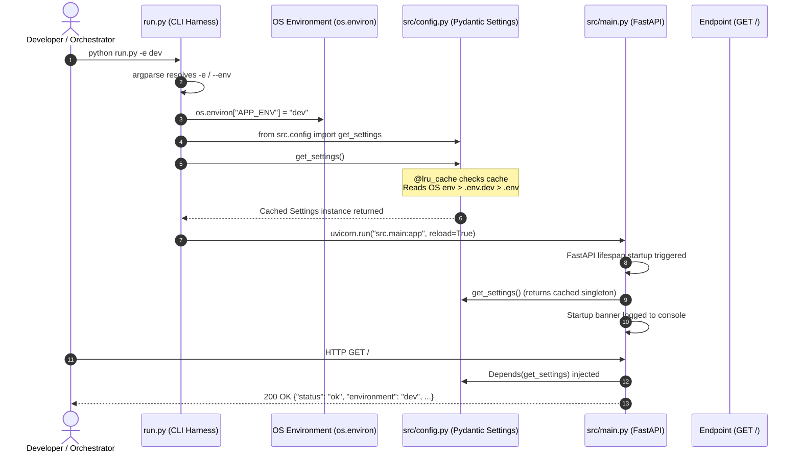

This guide provides an exhaustive architectural overview and a complete line-by-line code explanation of the three foundational files powering the application:
1. `src/config.py` — The Centralized Settings Singleton & Environment Resolver.
2. `run.py` — The Local Development Launcher & Server Bootstrap.
3. `src/main.py` — The FastAPI Application, Lifespan Protocol & Route Injection.

---

# Part 1: The Architectural Mechanism



---

## 1. Core Architectural Principles

### A. The 12-Factor App Methodology (Factor III: Config)
Enterprise systems mandate that **code and configuration remain strictly separated**:
- An application image (such as a Docker container) must be built **once** and deployed identically across Development, Staging, and Production.
- Environment-specific values (API endpoints, credentials, feature flags, ports) must be injected through the **operating system environment**, never hardcoded into source code.
- `.env` files are strictly tools for **local developer convenience**. In real production deployments (Kubernetes, AWS ECS, GCP Cloud Run), secrets and variables are injected into container environments via `ConfigMaps`, `Secrets`, or Vault.

### B. Separation of Concerns
The application cleanly segregates duties across three layers:

| File | Layer | Primary Responsibility |
| :--- | :--- | :--- |
| `src/config.py` | **Configuration Layer** | Type-safe schema validation, parsing, environment variable binding, and caching. Zero server logic. |
| `run.py` | **Development Entrypoint** | Local developer CLI flags parsing (`argparse`), bootstrapping OS environment variables, and starting Uvicorn with hot-reloading. |
| `src/main.py` | **Application Layer** | FastAPI application definition, lifespan initialization, route definitions, and business routing. |

### C. The Configuration Precedence Cascade
When `Settings()` is instantiated, `pydantic-settings` resolves every field using the following strict priority order:
1. **Host OS Environment Variables** (highest priority: e.g. `export APP_ENV=prod` or Kubernetes secrets).
2. **Environment-Specific Dotenv File** (`.env.<APP_ENV>`, e.g. `.env.prod` or `.env.dev`).
3. **Base Dotenv File** (`.env` for shared baseline defaults).
4. **Class Field Defaults** in Python code (fallback defaults defined in `Settings`).

---

## 2. Dependency Injection and The Singleton Pattern

### Why `@lru_cache` on `get_settings()`?
1. **Performance**: Parsing `.env` files from disk, reading OS environment variables, and running Pydantic type validation on every incoming HTTP request is computationally expensive.
2. **Object Consistency**: By decorating `get_settings()` with `@lru_cache`, Python instantiates the `Settings` class **exactly once**. Every route, middleware, or background task receives a reference to the exact same settings instance in memory.
3. **FastAPI Compatibility**: FastAPI route handlers utilize `Depends(get_settings)`. Because `get_settings()` requires zero arguments, FastAPI can resolve and inject it automatically into any route function.
4. **Effortless Unit Testing**: In automated tests, you never need to mock disk files or mutate global variables. You can override settings dynamically:
   ```python
   app.dependency_overrides[get_settings] = lambda: Settings(APP_ENV="test")
   ```

---

## 3. The FastAPI Modern Lifespan Protocol

FastAPI deprecated `@app.on_event("startup")` and `@app.on_event("shutdown")` in favor of the **ASGI Lifespan context manager**:
- Any code placed **before** the `yield` statement executes precisely once when the server process boots up (ideal for validating database connections, pre-loading machine learning models, or printing startup banners).
- When a `SIGTERM` or `SIGINT` (Ctrl+C) signal arrives, FastAPI resumes execution **after** the `yield` statement, allowing for graceful socket teardown, database pool closing, and resource cleanup.

---

## 4. Local Development vs. Enterprise Production

| Dimension         | Local Development                       | Enterprise Production                                                         |
| :---------------- | :-------------------------------------- | :---------------------------------------------------------------------------- |
| **Command**       | `python run.py -e dev`                  | `uvicorn src.main:app --host 0.0.0.0 --port 8000 --workers 4`                 |
| **Entrypoint**    | `run.py` CLI script                     | Direct ASGI runner in Docker `CMD` / Kubernetes Pod spec                      |
| **Hot Reloading** | Active (`reload=True`) via file-watcher | Disabled (`reload=False`) for maximum throughput and stability                |
| **Config Source** | `.env.dev` / `.env` files on disk       | Kubernetes `ConfigMap` / `Secret` injected as container environment variables |

---

# Part 2: Line-by-Line Code Breakdown

---

## File 1: `src/config.py`

``` python
import os
from functools import lru_cache
from typing import Literal
from pydantic_settings import BaseSettings, SettingsConfigDict

class Settings(BaseSettings):
    """
    Application settings powered by Pydantic.
    Reads from OS environment variables first, then falls back to local .env files.
    """

    # Environment
    APP_ENV: Literal["dev", "staging", "prod", "test"] = "dev"

    # External APIs
    ECOMMERCE_API_BASE_URL: str = "https://fakestoreapi.com"

    # Server Configuration (for local runner / dev defaults)
    HOST: str = "0.0.0.0"
    PORT: int = 8000

    model_config = SettingsConfigDict(
        # Precedence: OS env vars > .env.<APP_ENV> > .env
        env_file=(
            f".env.{os.getenv('APP_ENV', 'dev')}",
            ".env",
        ),
        env_file_encoding="utf-8",
        extra="ignore",
        case_sensitive=False,
    )

@lru_cache
def get_settings() -> Settings:
    """
    Dependency injection provider returning a cached Settings singleton.
    Can be overridden in tests using app.dependency_overrides[get_settings].
    """
    return Settings()
```

### Detailed Line-by-Line Explanation

* **Line 1: `import os`**  
  Imports Python's standard operating system interface module. Used on Line 25 to inspect `os.getenv("APP_ENV")` so the class knows which `.env` file to select.
* **Line 2: `from functools import lru_cache`**  
  Imports the Least Recently Used (LRU) cache decorator from the standard library. Used on Line 34 to transform `get_settings()` into a memoized singleton function.
* **Line 3: `from typing import Literal`**  
  Imports the `Literal` type hint from the `typing` module. Constrains a string to an exact set of allowed values at type-check time.
* **Line 4: `from pydantic_settings import BaseSettings, SettingsConfigDict`**  
  Imports `BaseSettings` (the base class that enables Pydantic models to automatically read values from system environment variables and `.env` files) and `SettingsConfigDict` (the type-safe configuration dictionary class for configuring how settings are loaded).
* **Line 5–6:** Blank lines separating module imports from class definitions per PEP 8 standards.
* **Line 7: `class Settings(BaseSettings):`**  
  Defines the application settings model inheriting from `BaseSettings`. Any attribute defined inside this class automatically maps to an environment variable of the same name.
* **Line 8–11:** Class docstring explaining the purpose of the model, noting that system environment variables take priority over disk files.
* **Line 12: `# Environment`**  
  Section divider comment categorizing environmental fields.
* **Line 13: `APP_ENV: Literal["dev", "staging", "prod", "test"] = "dev"`**  
  Declares the `APP_ENV` variable.  
  - `Literal["dev", "staging", "prod", "test"]`: Guarantees that only these four string values are permissible. If an unsupported value (e.g. `APP_ENV=qa`) is supplied, Pydantic raises a validation error immediately on boot.  
  - `= "dev"`: Assigns `"dev"` as the fallback default if no environment variable or file provides a value.
* **Line 14:** Blank line for readability.
* **Line 15: `# External APIs`**  
  Section divider comment for upstream integration URLs.
* **Line 16: `ECOMMERCE_API_BASE_URL: str = "https://fakestoreapi.com"`**  
  Declares the base URL for the upstream ecommerce REST service, typed as a `str` and assigned a default mock API URL. In production, this gets overridden by an environment variable.
* **Line 17:** Blank line.
* **Line 18: `# Server Configuration (for local runner / dev defaults)`**  
  Comment denoting server networking fields.
* **Line 19: `HOST: str = "0.0.0.0"`**  
  The network interface IP address the server will bind to. `"0.0.0.0"` instructs the socket to listen on all available network adapters (essential for Docker containers to be reachable outside the container).
* **Line 20: `PORT: int = 8000`**  
  The TCP port number on which the HTTP server will accept incoming connections, typed as an `int`.
* **Line 21:** Blank line.
* **Line 22: `model_config = SettingsConfigDict(`**  
  Configures the internal behavior of the Pydantic settings loader using `SettingsConfigDict`.
* **Line 23: `# Precedence: OS env vars > .env.<APP_ENV> > .env`**  
  Comment documenting the order of file evaluation.
* **Line 24: `env_file=(`**  
  Passes a tuple of file paths to `env_file`. Pydantic reads tuples in order; earlier entries override later ones.
* **Line 25: `f".env.{os.getenv('APP_ENV', 'dev')}",`**  
  Dynamically builds the environment-specific dotenv file path (e.g. `.env.dev` or `.env.prod`) by checking the current OS environment variable `APP_ENV` (defaulting to `"dev"`).
* **Line 26: `".env",`**  
  Specifies the generic `.env` file as a secondary fallback for shared local variables across all environments.
* **Line 27: `),`**  
  Closes the `env_file` tuple.
* **Line 28: `env_file_encoding="utf-8",`**  
  Ensures `.env` files are parsed using standard UTF-8 text encoding, preventing encoding crashes across different operating systems.
* **Line 29: `extra="ignore",`**  
  Instructs Pydantic to ignore any extra environment variables present in the OS or `.env` files (such as `PATH`, `USER`, `COMPUTERNAME`) that are not declared as fields on `Settings`. Without this, Pydantic would raise an `extra_forbidden` validation error on startup.
* **Line 30: `case_sensitive=False,`**  
  Allows case-insensitive environment variable matching, meaning `app_env`, `App_Env`, and `APP_ENV` all map to the same field.
* **Line 31: `)`**  
  Closes the `model_config` assignment.
* **Line 32–33:** Blank lines.
* **Line 34: `@lru_cache`**  
  Applies Python's memoization decorator. On the first call, `get_settings()` executes and stores the `Settings` instance in memory. All subsequent calls return the cached object instantly with zero disk or environment overhead.
* **Line 35: `def get_settings() -> Settings:`**  
  Defines the parameterless dependency injection provider function returning a `Settings` instance.
* **Line 36–39:** Docstring detailing the singleton nature of the function and its ability to be overridden in testing environments.
* **Line 40: `return Settings()`**  
  Instantiates and returns the `Settings` model.

---

## File 2: `run.py`

```python
"""
run.py — Local developer entrypoint and server launcher.

In enterprise production (Docker / Kubernetes), the ASGI server is executed directly:
    uvicorn src.main:app --host 0.0.0.0 --port 8000 --workers 4

For local development, this script bootstraps the environment and launches Uvicorn
with auto-reload enabled in 'dev' mode.

Usage:
    python run.py               # Runs in dev (or inherits $APP_ENV if set)
    python run.py --env prod    # Runs in prod mode
    python run.py -e prod       # Short flag syntax
"""

import argparse
import os
import uvicorn

def main():
    parser = argparse.ArgumentParser(description="Multi-Agent Platform Local Development Runner")
    parser.add_argument(
        "-e",
        "--env",
        choices=["dev", "prod", "staging", "test"],
        default=os.getenv("APP_ENV", "dev"),
        help="Target execution environment (default: $APP_ENV or 'dev')",
    )

    args = parser.parse_args()
    os.environ["APP_ENV"] = args.env

    # Import settings after environment variable is established
    from src.config import get_settings

    settings = get_settings()
    is_dev = settings.APP_ENV == "dev"

    print(f"[run.py] Starting local Uvicorn server in {settings.APP_ENV.upper()} mode...")
    uvicorn.run(
        "src.main:app",
        host=settings.HOST,
        port=settings.PORT,
        reload=is_dev,
        log_level="info",
    )

if __name__ == "__main__":
    main()
```

### Detailed Line-by-Line Explanation

* **Line 1–14:** Module-level docstring documenting the purpose of `run.py` as a developer-facing tool, clarifying production command equivalents (`uvicorn src.main:app`), and providing example CLI invocations.
* **Line 15:** Blank line.
* **Line 16: `import argparse`**  
  Imports Python's standard command-line argument parsing library.
* **Line 17: `import os`**  
  Imports the operating system module to read and set environment variables.
* **Line 18: `import uvicorn`**  
  Imports the lightning-fast ASGI web server implementation.
* **Line 19–20:** Blank lines.
* **Line 21: `def main():`**  
  Encapsulates the CLI parsing and server execution logic within a function, preventing global namespace pollution.
* **Line 22: `parser = argparse.ArgumentParser(description="Multi-Agent Platform Local Development Runner")`**  
  Initializes an argument parser instance with a human-readable description displayed when `--help` is requested.
* **Line 23: `parser.add_argument(`**  
  Registers a command-line option on the parser.
* **Line 24: `"-e",`**  
  Registers the short single-dash flag alias (`-e`).
* **Line 25: `"--env",`**  
  Registers the canonical double-dash option flag (`--env`).
* **Line 26: `choices=["dev", "prod", "staging", "test"],`**  
  Enforces input validation at the CLI level. If an invalid value like `python run.py -e unknown` is passed, `argparse` displays an error and exits immediately without running the app.
* **Line 27: `default=os.getenv("APP_ENV", "dev"),`**  
  Sets the default value dynamically. If the OS environment already defined `APP_ENV`, that value is preserved; otherwise, it defaults to `"dev"`.
* **Line 28: `help="Target execution environment (default: $APP_ENV or 'dev')",`**  
  Provides the help text displayed in the terminal when running `python run.py -h`.
* **Line 29: `)`**  
  Closes the `add_argument` call.
* **Line 30:** Blank line.
* **Line 31: `args = parser.parse_args()`**  
  Parses the command-line arguments passed into `sys.argv` and stores the resulting namespace object in `args`.
* **Line 32: `os.environ["APP_ENV"] = args.env`**  
  **Crucial Step:** Writes the resolved environment name directly into the operating system's process environment. This ensures that any module imported afterwards can access `APP_ENV` from `os.environ`.
* **Line 33:** Blank line.
* **Line 34: `# Import settings after environment variable is established`**  
  Explains the deliberate placement of the next import.
* **Line 35: `from src.config import get_settings`**  
  Imports `get_settings` lazily *after* `os.environ["APP_ENV"]` is set. This guarantees that `SettingsConfigDict` reads the correct `.env.<APP_ENV>` file on its initial instantiation.
* **Line 36:** Blank line.
* **Line 37: `settings = get_settings()`**  
  Calls the settings provider to load and validate configuration.
* **Line 38: `is_dev = settings.APP_ENV == "dev"`**  
  Computes a boolean flag. Returns `True` if running in development mode, otherwise `False`.
* **Line 39:** Blank line.
* **Line 40: `print(f"[run.py] Starting local Uvicorn server in {settings.APP_ENV.upper()} mode...")`**  
  Prints an informative console message confirming which environment profile is being launched.
* **Line 41: `uvicorn.run(`**  
  Invokes the Uvicorn ASGI server programmatically.
* **Line 42: `"src.main:app",`**  
  Passes the application as an import string rather than an in-memory object (`app`). **Important:** Passing a string is mandatory for Uvicorn's `reload=True` mechanism to work, because worker subprocesses must re-import the module from scratch when files change.
* **Line 43: `host=settings.HOST,`**  
  Binds the server to the configured host IP (`0.0.0.0`).
* **Line 44: `port=settings.PORT,`**  
  Binds the server to the configured port number (`8000`).
* **Line 45: `reload=is_dev,`**  
  Enables auto-reload only when `is_dev` is `True`. In `prod` or `staging` modes, code-watching is disabled to avoid CPU overhead and accidental reboots.
* **Line 46: `log_level="info",`**  
  Configures the logging verbosity of the ASGI server to standard informational output.
* **Line 47: `)`**  
  Closes the `uvicorn.run` call.
* **Line 48–49:** Blank lines.
* **Line 50: `if __name__ == "__main__":`**  
  Standard Python boilerplate ensuring that `main()` is only invoked when the file is run directly (`python run.py`), preventing it from running if imported by another script or spawned by Windows multiprocessing workers.
* **Line 51: `main()`**  
  Executes the entrypoint function.

---

## File 3: `src/main.py`

```python
from contextlib import asynccontextmanager
from fastapi import Depends, FastAPI
from src.config import Settings, get_settings

@asynccontextmanager
async def lifespan(app: FastAPI):
    """
    Lifespan context manager that runs once on startup and once on shutdown.
    Replaces deprecated @app.on_event handlers.
    """
    settings = get_settings()

    print("=" * 64)
    print("  Multi-Agent Business Orchestration Platform Starting")
    print(f"  Environment       : {settings.APP_ENV.upper()}")
    print(f"  Ecommerce Base URL: {settings.ECOMMERCE_API_BASE_URL}")
    print("=" * 64)

    yield

    print("Shutting down Multi-Agent Business Orchestration Platform cleanly...")

app = FastAPI(
    title="Multi-Agent Business Orchestration",
    description="Enterprise multi-agent orchestration platform.",
    version="0.1.0",
    lifespan=lifespan,
)

@app.get("/", tags=["Health"])
async def root(settings: Settings = Depends(get_settings)):
    """Health-check endpoint returning the active environment configuration."""
    return {
        "status": "ok",
        "environment": settings.APP_ENV,
        "ecommerce_api": settings.ECOMMERCE_API_BASE_URL,
    }

@app.get("/health", tags=["Health"])
async def health():
    """Liveness probe endpoint for Kubernetes / load balancers."""
    return {"status": "healthy"}
```

### Detailed Line-by-Line Explanation

* **Line 1: `from contextlib import asynccontextmanager`**  
  Imports the `asynccontextmanager` decorator from Python's standard `contextlib` library, enabling the creation of asynchronous context managers using the `async with` protocol.
* **Line 2: `from fastapi import Depends, FastAPI`**  
  Imports `FastAPI` (the core ASGI web framework class) and `Depends` (the dependency injection helper for declaring parameters injected at request time).
* **Line 3: `from src.config import Settings, get_settings`**  
  Imports the `Settings` type for type annotations and the `get_settings` factory function for dependency injection.
* **Line 4–5:** Blank lines.
* **Line 6: `@asynccontextmanager`**  
  Decorates `lifespan` as an asynchronous context manager complying with the ASGI lifespan specification.
* **Line 7: `async def lifespan(app: FastAPI):`**  
  Defines the lifespan handler function, which accepts the running `FastAPI` instance as its argument.
* **Line 8–11:** Function docstring explaining that this replaces deprecated `@app.on_event("startup")` and `@app.on_event("shutdown")` decorators.
* **Line 12: `settings = get_settings()`**  
  Retrieves the cached `Settings` singleton instance.
* **Line 13: `print("=" * 64)`**  
  Outputs a terminal border line consisting of 64 equals signs (`=`).
* **Line 14: `print("  Multi-Agent Business Orchestration Platform Starting")`**  
  Outputs the application startup title.
* **Line 15: `print(f"  Environment       : {settings.APP_ENV.upper()}")`**  
  Prints the active environment name converted to uppercase (e.g. `DEV` or `PROD`).
* **Line 16: `print(f"  Ecommerce Base URL: {settings.ECOMMERCE_API_BASE_URL}")`**  
  Prints the resolved external upstream service URL to verify configuration upon startup.
* **Line 17: `print("=" * 64)`**  
  Outputs the closing terminal border line.
* **Line 18: `yield`**  
  **The Lifespan Pivot Point:** Pauses function execution and hands control over to the FastAPI application to process incoming HTTP requests. The application stays alive at this line for its entire lifespan.
* **Line 19: `print("Shutting down Multi-Agent Business Orchestration Platform cleanly...")`**  
  Resumes execution once the server receives a termination signal (`SIGTERM`/`SIGINT`), logging a clean shutdown message.
* **Line 20–21:** Blank lines.
* **Line 22: `app = FastAPI(`**  
  Instantiates the central FastAPI application object.
* **Line 23: `title="Multi-Agent Business Orchestration",`**  
  Configures the API title displayed on interactive documentation pages (`/docs` and `/redoc`).
* **Line 24: `description="Enterprise multi-agent orchestration platform.",`**  
  Configures the OpenAPI documentation description.
* **Line 25: `version="0.1.0",`**  
  Sets the semantic version of the application.
* **Line 26: `lifespan=lifespan,`**  
  Binds the `lifespan` context manager defined on Line 7 to the FastAPI application.
* **Line 27: `)`**  
  Closes the `FastAPI` instantiation.
* **Line 28–29:** Blank lines.
* **Line 30: `@app.get("/", tags=["Health"])`**  
  Registers a route decorator handling HTTP `GET` requests to the root path (`/`), grouped under the `"Health"` category in OpenAPI docs.
* **Line 31: `async def root(settings: Settings = Depends(get_settings)):`**  
  Defines the asynchronous endpoint handler.  
  - `settings: Settings = Depends(get_settings)`: Instructs FastAPI to call `get_settings()`, resolve the cached `Settings` singleton, and inject it as the `settings` variable.
* **Line 32: `"""Health-check endpoint returning the active environment configuration."""`**  
  Endpoint docstring used as the route description in Swagger UI.
* **Line 33: `return {`**  
  Constructs and returns a Python dictionary serialized into JSON by FastAPI.
* **Line 34: `"status": "ok",`**  
  Indicates nominal service health.
* **Line 35: `"environment": settings.APP_ENV,`**  
  Echoes the active runtime environment.
* **Line 36: `"ecommerce_api": settings.ECOMMERCE_API_BASE_URL,`**  
  Echoes the active upstream target URL.
* **Line 37: `}`**  
  Closes the dictionary.
* **Line 38–39:** Blank lines.
* **Line 40: `@app.get("/health", tags=["Health"])`**  
  Registers an ultra-lightweight HTTP `GET` route at `/health`.
* **Line 41: `async def health():`**  
  Defines the liveness handler without dependencies or database overhead.
* **Line 42: `"""Liveness probe endpoint for Kubernetes / load balancers."""`**  
  Documents that this endpoint is designed for automated orchestrator health checks.
* **Line 43: `return {"status": "healthy"}`**  
  Returns a static JSON payload confirming the service process is alive and responsive.
