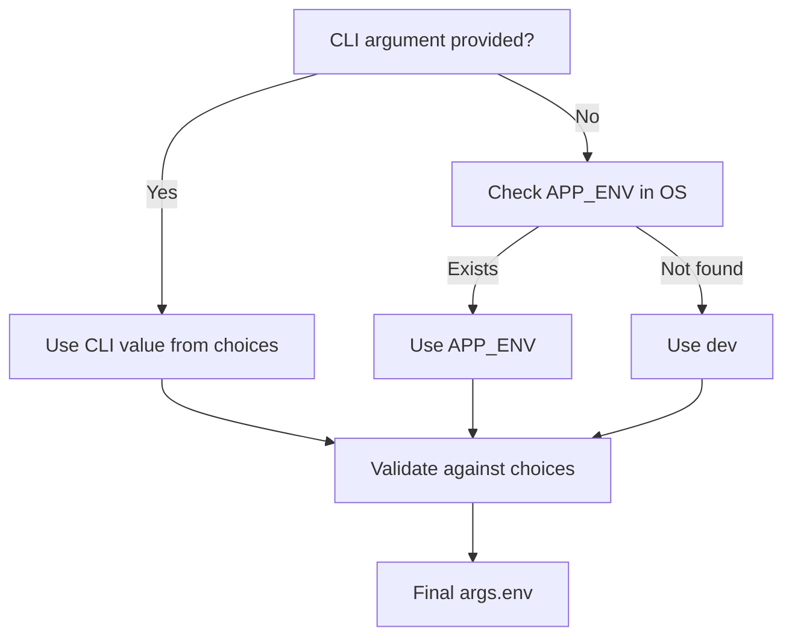

```python
if __name__ == "__main__":
    main()
```

This defines that this file cant be imported and must be run on its own. It runs the main function.

```python
    parser = argparse.ArgumentParser(description="Multi-Agent Platform Local Development Runner")
```

argparse object is used for parsing any arguement given in cli like --help or --version

```python
    parser.add_argument(
        "-e",
        "--env",
        choices=["dev", "prod", "staging", "test"],
        default=os.getenv("APP_ENV", "dev"),
        help="Target execution environment (default: $APP_ENV or 'dev')",
    )
```

mainly it does this.
- if cli value is there then use that
- if no cli value then use environment variable of system.
- if no environment variable in os, start on dev.
- Whatever method it is, it must be in the choice array.



Now we made a parser, think of it like a string reader, now it knows what to search for. time to use it.

`args = parser.parse_args()` this will actually parse the cli arguement to find what it matched. 
For safekeeping we also store this env info in environment variables as  
`os.environ["APP_ENV"] = args.env`

